<div align="center">

# Client Websites

**Коммерческие сайты на Tilda с собственным кодом: дизайн, вёрстка, запуск · 2025–2026**


</div>

---

Семь живых сайтов: заведение, премия, медиа, три фестиваля и страница романа. Подход везде один: вместо стандартных блоков Tilda каждая страница собрана из собственного HTML, CSS и JS внутри HTML-блоков. Это даёт полную свободу в дизайне, а домен, формы, хостинг и привычная для заказчика админка остаются на платформе. Код пишется в паре с ИИ (Claude): я отвечаю за арт-направление, структуру, тексты, проверку и запуск.

> **Коротко для нанимающего.** Веб-дизайн и сборка сайтов на Tilda под ключ: от айдентики и структуры до адаптива, форм и запуска. Свой код внутри Tilda вместо шаблонных блоков. AI в работе каждый день: код, тексты, визуалы. Все сайты ниже живые, их можно открыть с телефона.

| | Проект | Тип | Ссылка |
|---|---|---|---|
| 01 | Клуб Путешественников | Заведение: кофейня, библиотека, сигарный кабинет | [kpsuzdal.ru](https://kpsuzdal.ru) |
| 02 | Hookah Cigars Award | Сайт ежегодной дегустационной премии | [hookahcigarsaward.com](https://hookahcigarsaward.com) |
| 03 | Hookah Cigars | Медиа-портал: рейтинги, гайды, журнал | [hookahcigars.ru](https://hookahcigars.ru) |
| 04 | Suzdal Blues | Блюз-байк фестиваль | [suzdalblues.com](https://suzdalblues.com) |
| 05 | МОТОГРАФ | Фестиваль документального кино о мотокультуре | [motograph.ru](https://motograph.ru) |
| 06 | Ростов Райд | Фестиваль мото-музыкальной культуры | [rostovride.ru](https://rostovride.ru) |
| 07 | ДОЛГОТА | Страница романа Максима Привезенцева | [maximprivezentsev.com/dolgota](https://maximprivezentsev.com/dolgota) |

### Мобильные версии

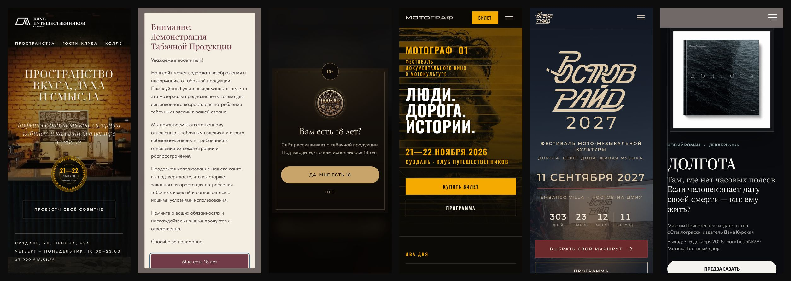

<sub>Слева направо: Клуб Путешественников, Hookah Cigars Award, Hookah Cigars, МОТОГРАФ, Ростов Райд, ДОЛГОТА · ширина экрана 390 px</sub>

---

## 01 · Клуб Путешественников

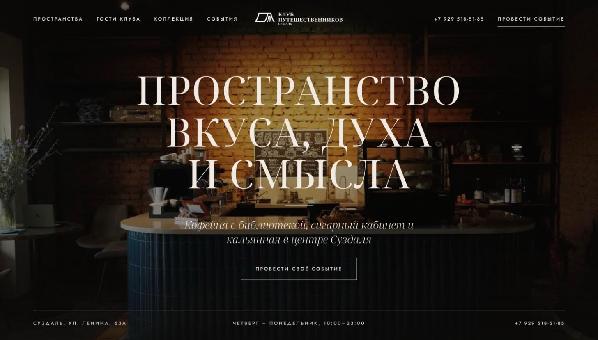

**Задача.** Переделать сайт заведения в центре Суздаля так, чтобы он соответствовал уровню гостей: «люкс со вкусом», а не просто премиум. Ориентиры: Vogue Café и YSL Café.

**Что сделано**
- полностью новый сайт в коде вместо стандартных блоков Tilda, включая замену модуля «Потоки»
- разделы: пространства, гости клуба, коллекция, события, отдельная страница аренды залов под частные мероприятия
- контент устроен так, чтобы администратор сам обновлял архив вечеров и меню без правки кода
- структура и тексты собраны под поисковый запрос «клуб путешественников»; перенесены разделы СЛОЙ01 и маршруты Suzdal Blues

---

## 02 · Hookah Cigars Award

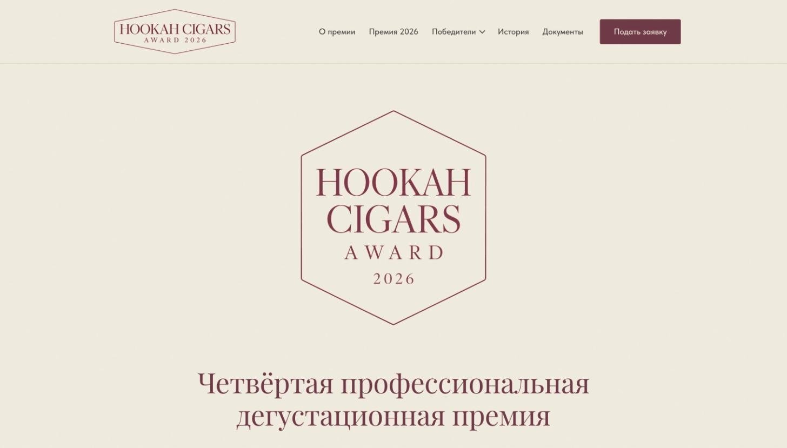
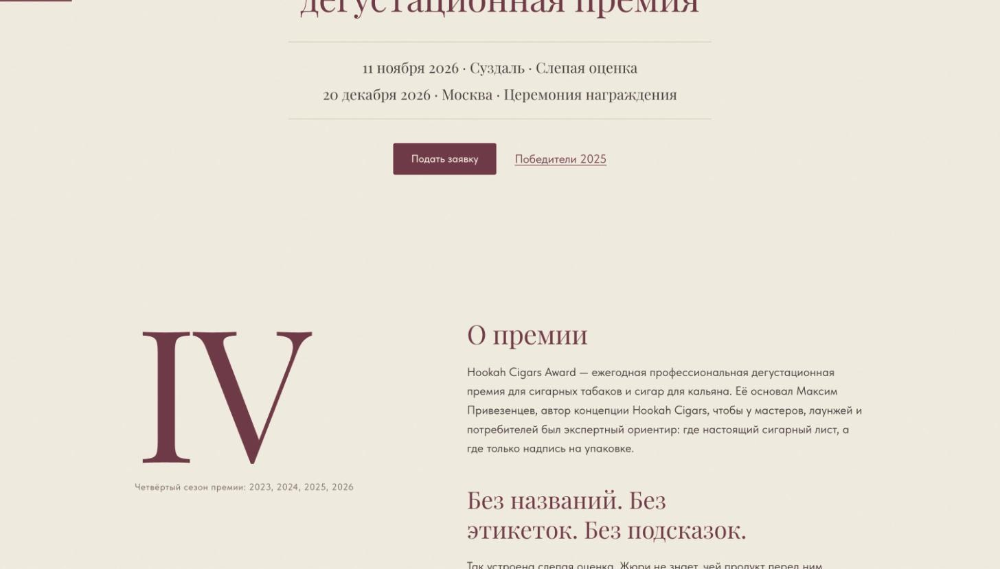

**Задача.** Перевести сайт премии на утверждённую айдентику 2026 года и сделать его «красиво и премиально», сохранив домен и архив прошлых сезонов.

**Что сделано**
- сайт заново написан в коде прямо в Tilda; старые страницы не удалены, а убраны в архивную папку
- новая айдентика: винная палитра, шестиугольная эмблема, классическая типографика, новый favicon
- выкладка через согласование: черновик и прототип на ревью до публикации, затем переключение на основные адреса

---

## 03 · Hookah Cigars

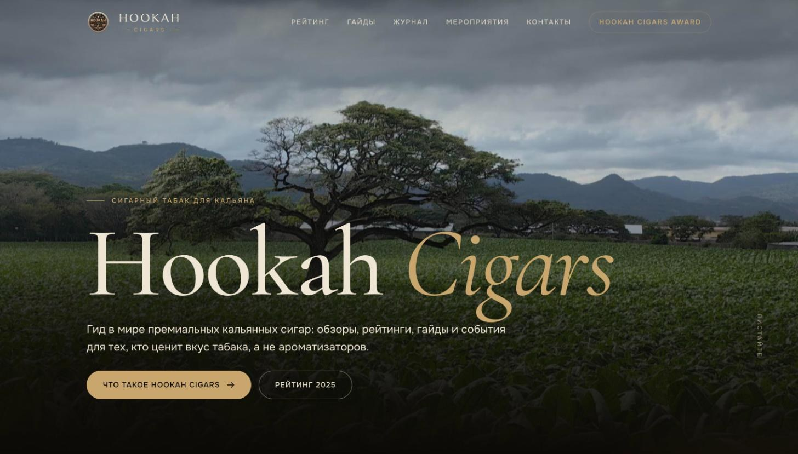

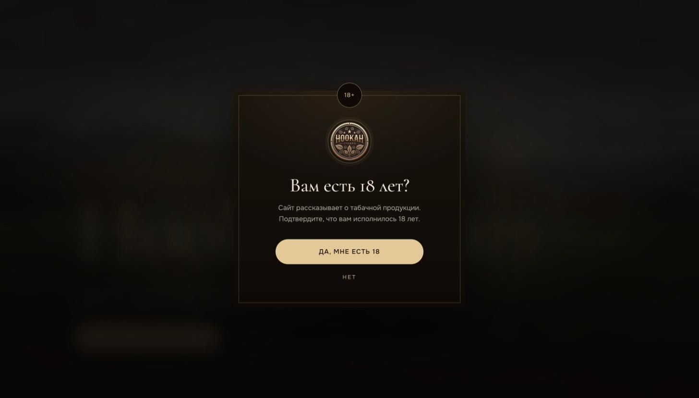

**Задача.** Сделать из портала о сигарном табаке для кальяна сайт премиального продукта.

**Что сделано**
- все блоки переписаны в коде в тёмной «табачной» стилистике с золотыми акцентами
- экран проверки возраста 18+ в стиле сайта
- нативные формы Tilda сохранены, чтобы заявки шли по привычным каналам
- запуск через скрытые тестовые адреса, на основные только после проверки

---

## 04 · Suzdal Blues

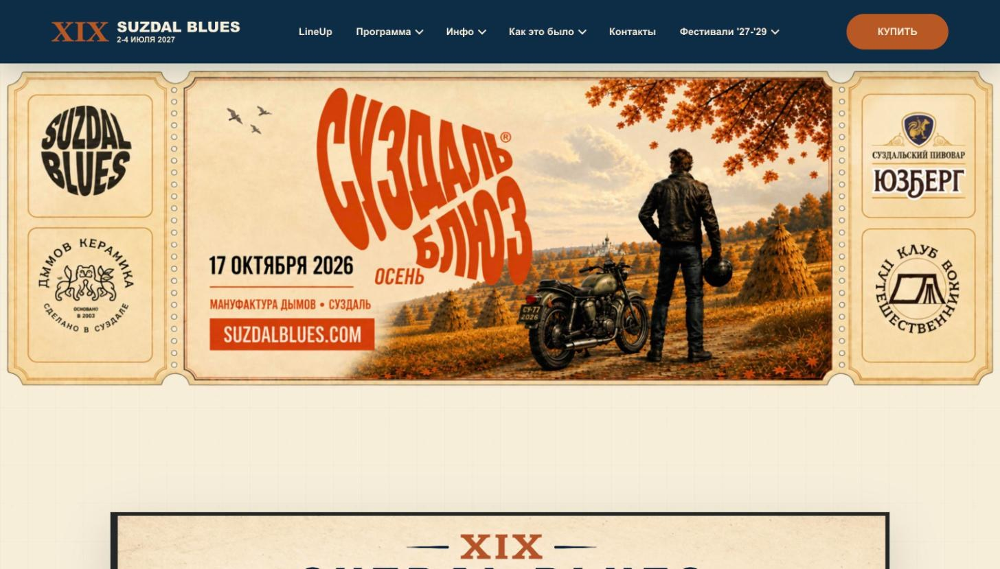
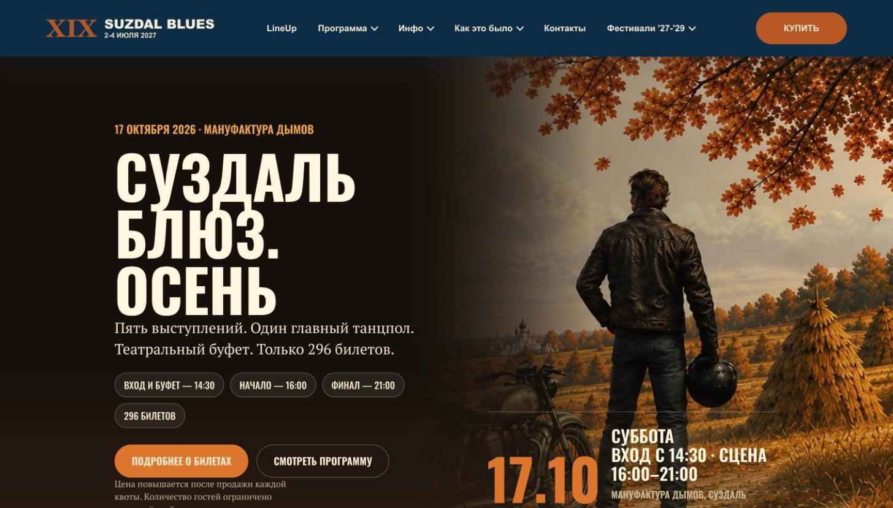

**Задача.** Поддерживать сайт крупного блюз-байк фестиваля и запускать на нём отдельные события.

**Что сделано**
- лендинг осеннего концерта «Суздаль Блюз. Осень» (17 октября 2026): программа, тайминг, билеты с ростом цены по квотам. Страница снята с сайта после концерта, здесь остались скриншоты
- новые страницы встраиваются в существующую навигацию и стиль фестиваля

---

## 05 · МОТОГРАФ

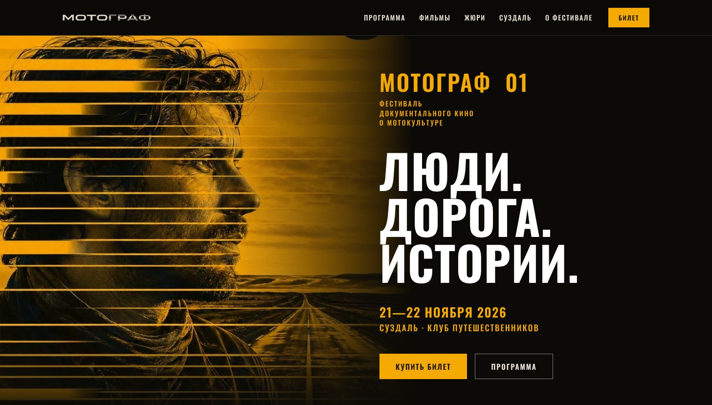

**Задача.** Сайт первого фестиваля документального кино о мотокультуре в Суздале.

**Что сделано**
- контрастная афишная стилистика: жёлтый на чёрном, крупная гротескная типографика, AI-визуал на первом экране
- разделы: программа, фильмы, жюри, Суздаль, о фестивале
- продажа билетов с первого экрана и из шапки

---

## 06 · Ростов Райд

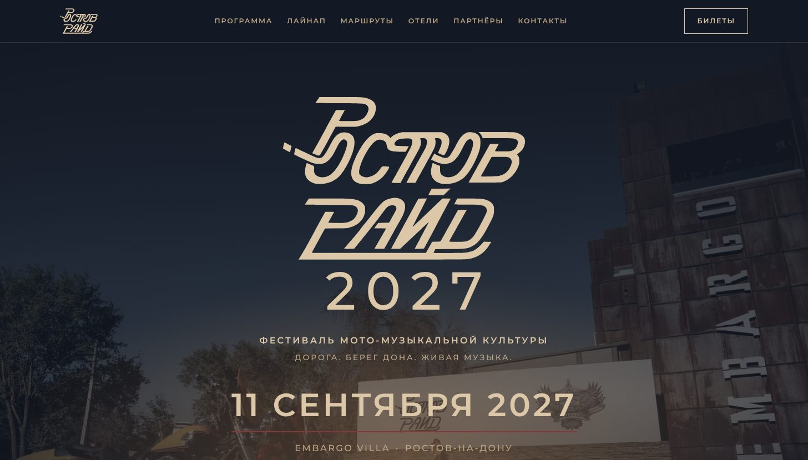

**Задача.** Сайт фестиваля мото-музыкальной культуры на берегу Дона.

**Что сделано**
- разделы: программа, лайнап, маршруты, отели, партнёры, контакты
- обратный отсчёт до фестиваля и выбор маршрута на первом экране мобильной версии
- билеты в шапке на всех экранах

---

## 07 · ДОЛГОТА

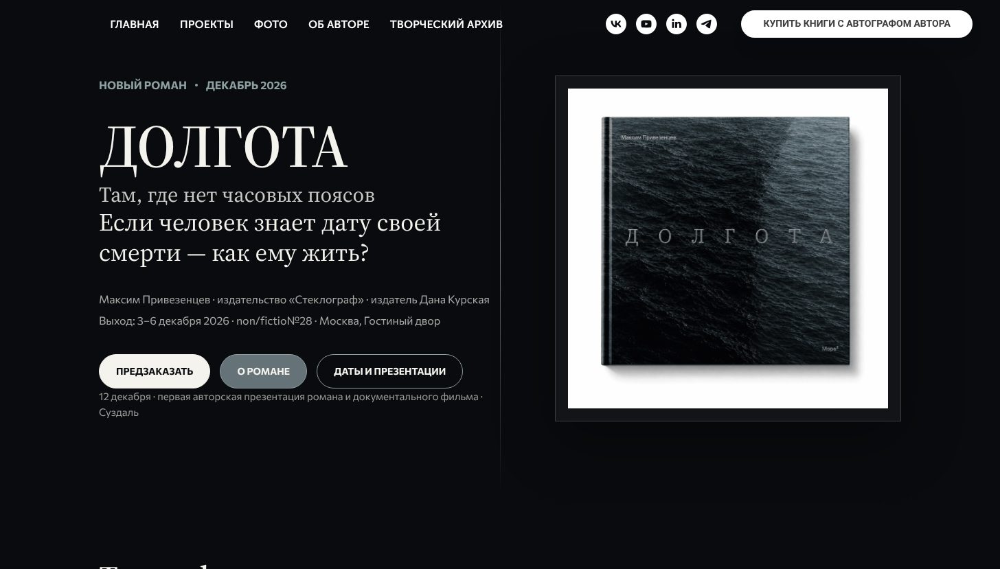

**Задача.** Страница нового романа Максима Привезенцева на авторском сайте к выходу книги в декабре 2026.

**Что сделано**
- спокойная книжная типографика с засечками на тёмном фоне, обложка как главный визуал
- предзаказ, описание романа, даты и места презентаций
- страница встроена в существующий сайт автора и его навигацию

---

## Как я работаю с AI

1. **Направление.** Сам задаю референсы, палитру, типографику и структуру страниц.
2. **Сборка.** Код блоков пишу в паре с Claude: ставлю задачу, читаю и правлю результат, слежу, чтобы стили не конфликтовали с Tilda.
3. **Визуалы.** Генерирую и дорабатываю изображения в нейросетях, когда нет фото (МОТОГРАФ, Suzdal Blues).
4. **Проверка.** Каждая страница сначала живёт на скрытом адресе: проверка на телефоне и десктопе, согласование с заказчиком.
5. **Запуск.** Переключение на основной адрес, нативные формы Tilda, чтобы заявки шли заказчику привычным путём.

---

## Как устроен код

Каждая страница — это набор HTML-блоков Tilda (T123) с изолированными стилями и скриптами:

```
page/
├── header        навигация, мобильное меню
├── hero          первый экран
├── sections/     контентные секции страницы
└── footer        контакты, подпись «design by 01»
```

- стили изолированы префиксами классов, чтобы не конфликтовать с Tilda
- отдельная вёрстка под мобильные и десктоп
- код в блоках отформатирован построчно, чтобы его могли читать и править другие

---

<p align="center"><sub>part of <a href="https://github.com/cent0n1y">cent0n1y</a> · design by 01</sub></p>
